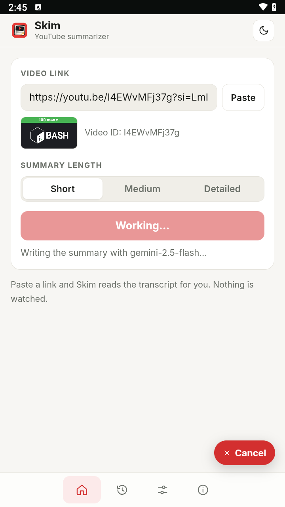
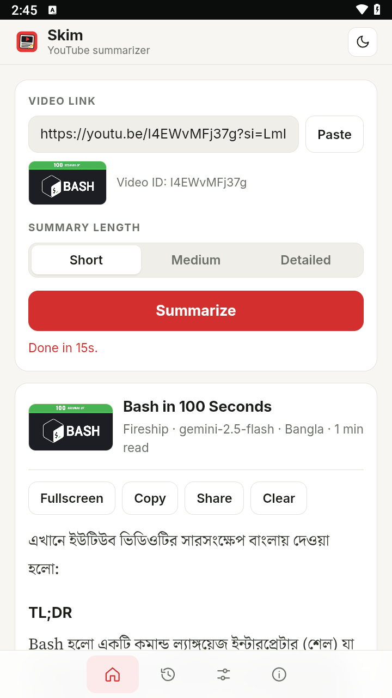
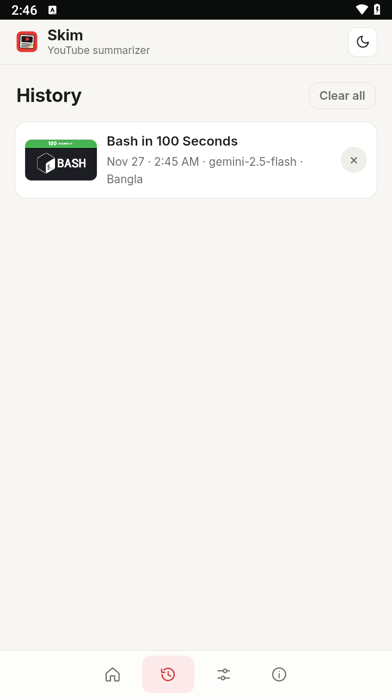
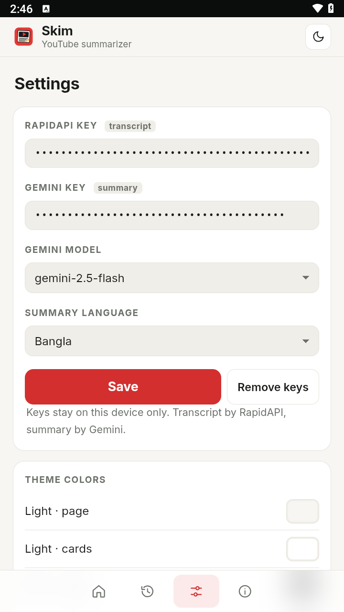
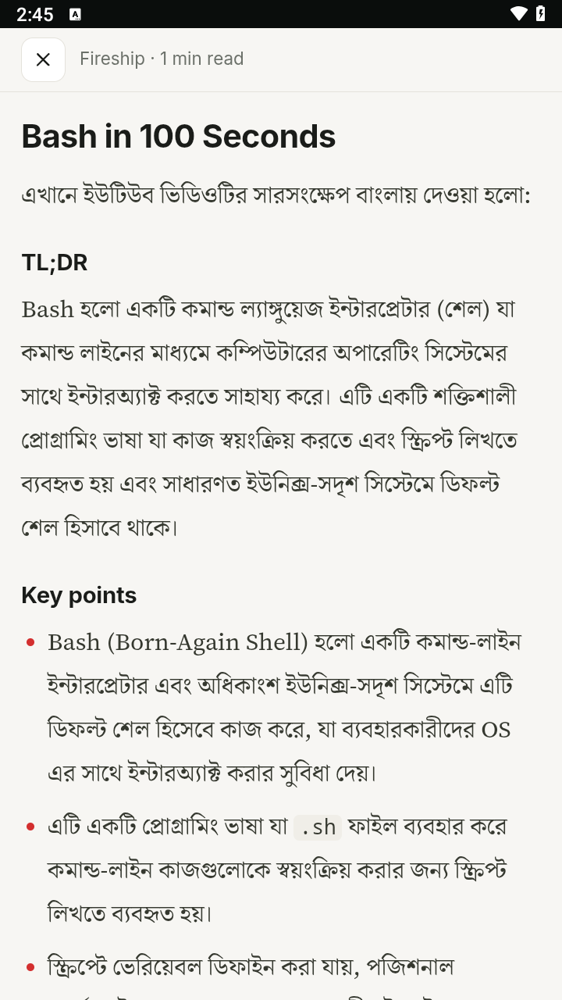

  

<h1 align="center">Skim</h1>

  <em>Youtube video summarizer - Paste a YouTube link, read the gist instead of watching the whole video.</em>

-3DDC84?logo=android&logoColor=white>)

   

<h2 align="center">Download</h2>

  

  <em>Requires Android 6+ (API 23)</em>

## What it does

Skim turns any YouTube video into a short summary. Paste a link and it fetches the transcript, then writes a TL;DR, key points, and takeaways in the language you pick — in seconds. Nothing is watched, nothing is stored beyond your device.

## Screenshots

  
  
  
  
  

## Features

- Paste any YouTube link (or pick one from the clipboard)
- Transcript fetched via RapidAPI, summary written by Gemini
- Summary length: short / medium / detailed
- TL;DR, key points, and takeaways in markdown
- Estimated read time and video thumbnail preview
- Copy or share the summary; fullscreen reading mode
- History of the last 20 summaries, stored on device
- Summary language: `Bangla, English, Hindi, Urdu, Arabic, Chinese, Japanese`
- Choose the Gemini model — presets plus any custom model name
- Dark / light theme, custom page & card colours
- Offline banner when there's no connection
- No ads, no account, no cloud sync

## Get your API keys

Skim needs two free API keys. Add both in **Settings** → they stay on this device only.

**1️⃣ YouTube Transcript API Key (RapidAPI)**

1. Visit: https://rapidapi.com/solid-api-solid-api-default/api/youtube-transcript3
2. Sign in to RapidAPI.
3. Subscribe to the API (free plan includes 100 requests per month).
4. Copy your API key.
5. In Skim, go to Settings, and paste the key there.

**2️⃣ Gemini API Key**

1. Visit Google AI Studio: https://aistudio.google.com/api-keys
2. Create a new API key.
3. Copy the key.
4. Paste it into Skim → Settings.

✅ Setup Complete! Great job 👏

## Get an APK (`for devs`)

1. Fork / clone this repo.
2. Push to GitHub → the **Build APK** workflow runs automatically.
3. Go to **Actions** → latest run → download the **Skim** artifact.
4. Install the APK on your Android device.

> Make sure **Play Protect is turned off** before installing.

## 🛠️ Built with

- Plain HTML, CSS, JS (no framework)
- Cloud build via GitHub Actions — no local Android SDK needed

## Origin

This app is built on top of the **WebView APK Template**:

> Base template: https://github.com/fazle-rabbi-dev/Web-View-Apk-Template

The template turns any **HTML/CSS/JS** site into an installable Android app with zero dependencies.

## Contributing

Issues and pull requests are welcome.

## Support

If this app helped you, consider giving it a star.

  Built with ❤️ by <a href="https://fazle-rabbi-dev.vercel.app/">Fazle Rabbi</a>

